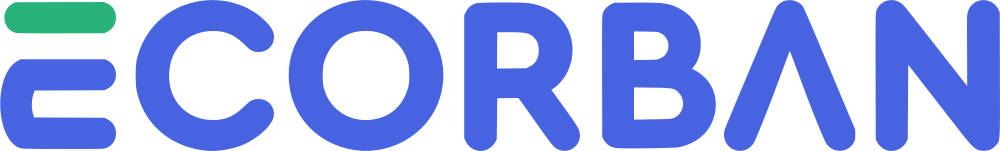

<div align="center">



### Landing page oficial do eCorban

**CRM e gestão para Corbans, correspondentes bancários e promotoras de crédito consignado.**
Do primeiro contato ao repasse pago, tudo em um só lugar.

[**Ver o site no ar →**](https://ecorban-next.vercel.app/)


</div>

---

## Sobre o projeto

Esta é a página de apresentação do **eCorban**, o sistema que organiza a operação de quem vende crédito consignado: esteira de propostas, atendimento, metas, comissões, repasses e financeiro.

O site foi pensado para **converter**: mostra o sistema funcionando, explica o caminho da proposta até o repasse, deixa os planos claros e leva o visitante direto para o teste grátis ou para o WhatsApp do time comercial.

Tudo é em português, responsivo de 320 a 1920 px, e os mockups reproduzem as telas reais do sistema (portal.ecorban.com), com os mesmos status, cores e nomes.

## O que tem no site

| Seção | O que faz |
| --- | --- |
| **Herói** | Apresenta a nova versão, com a foto da equipe e cartões do sistema (propostas pagas, comissões, meta e situação) flutuando ao redor. |
| **Clientes** | Faixa contínua com as empresas que já usam o eCorban. |
| **Módulos** | Abas interativas com as telas de Esteira, Clientes, Campanhas, Metas, Relatórios, Comissões, Financeiro, Simulações e Governança. |
| **Gente de verdade** | Mosaico de fotos e faixa de pessoas do sistema, com a logo do eCorban. |
| **Destaques** | Três cards empilhados com rolagem: Esteira única, Equipe ao Vivo e Comissões com repasse em lote. |
| **Como funciona** | Linha do tempo da proposta, do simulado ao repasse pago, com as cores reais dos status. |
| **Planos** | Seletor de usuários (3 a 320) e ciclos de cobrança, com os preços oficiais e o desconto à vista no boleto. |
| **Integrações** | Nuvem de recursos com ícones coloridos e chamada para o WhatsApp. |
| **Depoimentos** | Carrossel com vídeos de clientes reais. |
| **FAQ** | Perguntas frequentes em sanfona. |
| **CTA final** | Painel azul com um celular mostrando o sistema em movimento. |

### Detalhes de experiência

- **Abertura animada na primeira visita**: o "E" do eCorban se desenha na tela e a cortina sobe. Quem já visitou não vê de novo (um F5 carrega direto).
- **Movimento com intenção**: títulos que sobem linha a linha, cartões que entram em lote, cards que se empilham e círculos flutuantes (GSAP + Framer Motion). Quem usa "reduzir movimento" no sistema vê tudo já no estado final.
- **Celular do CTA** com o app simulando o uso: período que troca sozinho, números, meta e avisos que acompanham, e a esteira rolando.
- **Acessibilidade**: seletor de usuários como listbox navegável pelo teclado, foco visível e textos alternativos nas imagens.
- **Imagens otimizadas** (WebP, `next/image`) e logo em **SVG**, com favicon e ícone de tela inicial.

## Stack

- [Next.js 16](https://nextjs.org/) (App Router) e [React 19](https://react.dev/)
- [TypeScript](https://www.typescriptlang.org/)
- [Tailwind CSS 4](https://tailwindcss.com/)
- [GSAP](https://gsap.com/) (ScrollTrigger e SplitText) e [Framer Motion](https://www.framer.com/motion/)
- [Heroicons](https://heroicons.com/)
- Fonte [Figtree](https://fonts.google.com/specimen/Figtree) via `next/font`
- Deploy contínuo na [Vercel](https://vercel.com/)

## Como rodar

Pré-requisito: [Node.js](https://nodejs.org/) 20 ou superior.

```bash
# instalar as dependências
npm install

# servidor de desenvolvimento em http://localhost:3000
npm run dev

# conferir o código
npm run lint

# build de produção e servidor
npm run build
npm run start
```

## Estrutura

```
app/                  páginas, layout, ícone e estilos globais
components/
  sections/           cada seção da página (Hero, Modules, Pricing, FinalCta…)
  mock/               peças e telas do sistema usadas nos mockups
  mockups/            cartões do herói, mockups dos destaques e celular do CTA
  motion/             abertura animada e cenas de rolagem
  ui/                 botão, anel decorativo, título de seção, formulário…
content/              textos e dados editáveis (herói, módulos, planos, FAQ…)
lib/                  scripts inline e utilitários
public/               imagens, logos, avatares e vídeos
```

## Como editar o conteúdo

Os textos ficam separados do código, em `content/`:

| Arquivo | Conteúdo |
| --- | --- |
| `hero.ts` | Selo, título, subtítulo e formulário do herói |
| `modules.ts` | As abas de módulos e seus destaques |
| `showcases.ts` | Os três cards empilhados |
| `howItWorks.ts` | Passos da linha do tempo |
| `pricing.ts` | Tabela oficial de preços por faixa de usuários e ciclo |
| `testimonials.ts` | Depoimentos e vídeos |
| `faq.ts` | Perguntas frequentes |
| `site.ts` | Contatos, links de login e teste grátis e WhatsApp |

> Os preços em `pricing.ts` são os do site oficial e ficam guardados em centavos por mês. Não recalcule a partir do valor mensal: a partir de 60 usuários, o trimestral não é exatamente 5% menor.

## Deploy

O projeto está ligado à Vercel: **cada push na branch `main` publica uma nova versão** automaticamente em [ecorban-next.vercel.app](https://ecorban-next.vercel.app/).
